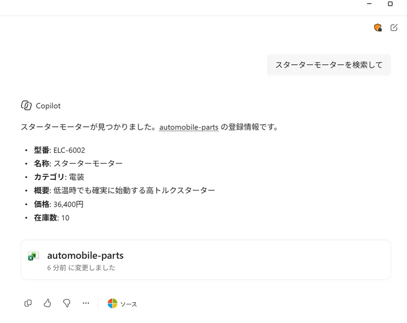
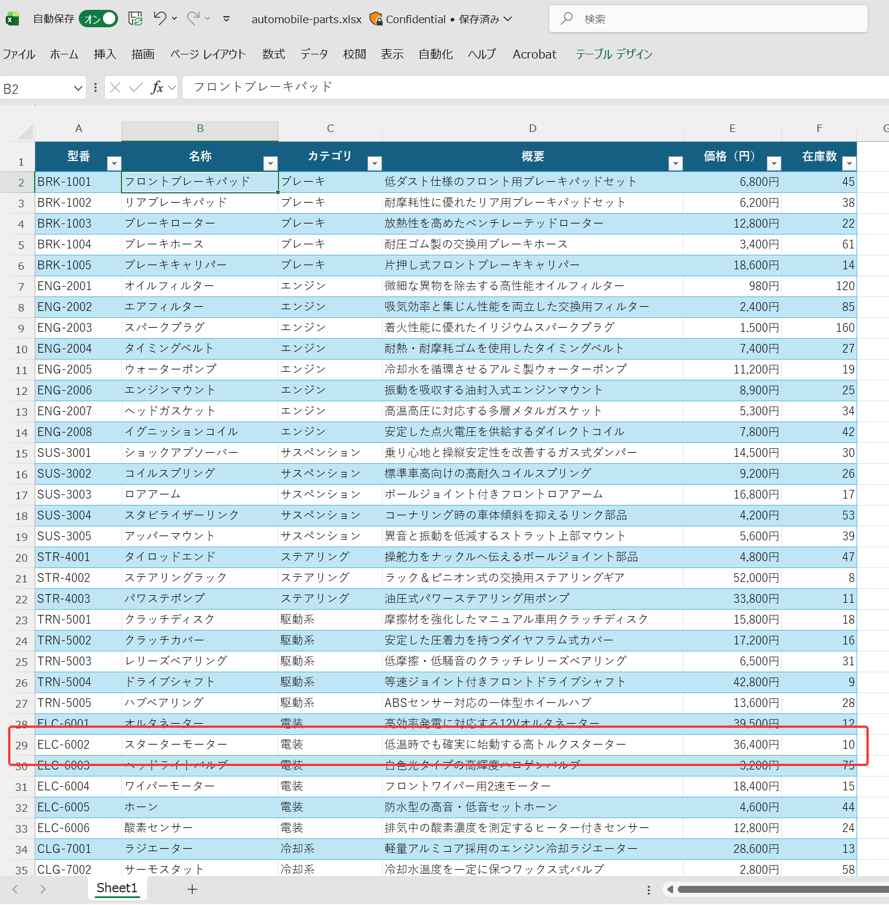

# Agent Builder 利用例

Excelファイル（部品表）を検索する「部品検索エージェント」

## Excelファイル

[automobile-parts.xlsx](automobile-parts.xlsx)

## 動作イメージ

エージェント動作イメージ

エージェントに添付するExcelファイルのイメージ

## 手順

- Copilotチャットで新しいエージェントの作成を開始
- 「自動車部品についてナレッジ（エージェントに添付されたExcelファイル ）に基づき回答するエージェント」とプロンプトを入力→エージェントが作成される
- 「部品検索エージェント」と名前を設定
- 「説明」に「自動車部品についてナレッジ（エージェントに添付されたExcelファイル ）に基づき回答するエージェント」と入力
- 「指示」に「自動車部品についてのユーザーからの質問に、ナレッジ（エージェントに添付されたExcel ）に基づき回答します」と設定
- 「ナレッジ」に自動車部品ファイルを添付（クラウドファイル/SharePoint/ 以下にExcelファイルが追加される）
- 「ナレッジ」のOutlookナレッジ、Teamsナレッジ、Web検索をOFFに設定
- 「作成」をクリック
- 「チャットを開始」をクリック
- エージェントに「スターターモーターを検索して」などと入力。エージェントはExcelファイルの該当する行を検索して回答する
